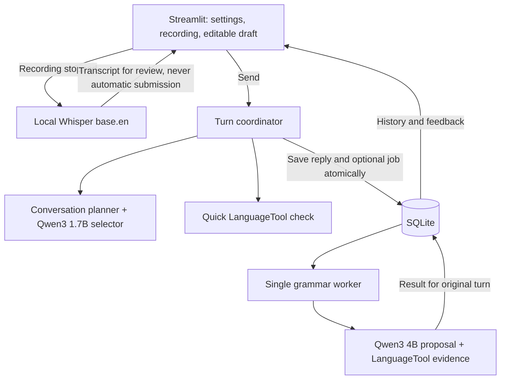

# 💬 Speakeasy

A local English-practice tutor. Type or record a message, review the transcript,
get a conversational reply, and see grammar suggestions. Models run on your
machine; sessions are stored in local SQLite.

[](pyproject.toml)
[](https://streamlit.io)
[](#configuration)
[](LICENSE)

**Jump to:** [Features](#features) · [Quickstart](#quickstart) · [Configuration](#configuration) · [Architecture](#architecture) · [Development](#development) · [Limitations](#limitations) · [Roadmap](#roadmap)

## Features

- **Practice:** 3 levels (beginner, intermediate, advanced) × 3 scenarios (daily activities, introductions, ordering food)
- **Voice input:** record, transcribe locally with Whisper, edit, then send. Nothing submits automatically.
- **Follow-ups:** prepared questions chosen by a local model, with short-term recall of names and hobbies
- **Grammar feedback:** instant rule-based suggestions, plus an optional full check
  (Qwen3 4B proposal verified by LanguageTool). Unsupported edits are withheld.
- **Saved sessions:** reopen past sessions from the sidebar; if saving fails, retry without regenerating the reply
- **Background checks:** single worker, cancellable, results tied to the original turn

## Quickstart

Requires macOS or Linux, **Python 3.12**, **[uv](https://docs.astral.sh/uv/)**, **[Ollama](https://ollama.com)**, and **Java 21** (for LanguageTool).

```bash
git clone https://github.com/LovejitGill/Speakeasy.git
cd Speakeasy
uv sync --locked
```

Run each of these in its own terminal:

```bash
# 1. Ollama (leave running)
bash tools/ollama.sh serve

# 2. One-time downloads (needs internet)
bash tools/ollama.sh pull qwen3:1.7b
bash tools/ollama.sh pull qwen3:4b
uv run --locked python tools/setup.py checker
uv run --locked python tools/setup.py speech

# 3. LanguageTool (leave running)
bash tools/checker.sh

# 4. App
uv run --locked streamlit run app.py
```

Open the URL Streamlit prints (usually http://127.0.0.1:8501), choose a level
and scenario, and click **Start new session**.

**Voice:** Record → Stop → review/edit the transcript → **Send**. Recordings are
0.3–60 s, mono 16 kHz WAV, up to 2 MB. Messages are limited to 1,000 characters.

Normal use never downloads models. If another Ollama is already on port 11434,
use that instance and model directory consistently.

More on spelling suggestions and phrase rules: [docs/feedback.md](docs/feedback.md)

## Configuration

Set variables in the terminal that launches each service.

| Variable | Default | Purpose |
|---|---|---|
| `SPEAKWELL_DB_PATH` | `data/practice.sqlite3` | SQLite database |
| `SPEAKWELL_SPEECH_MODEL` | `.models/faster-whisper-base.en` | Local Whisper model folder |
| `SPEAKWELL_LT_DIR` | `.tools/LanguageTool-6.6` | LanguageTool install (set for app and launcher) |
| `SPEAKWELL_JAVA` | `.tools/java` if present, else `java` | Java executable (set for app and launcher) |
| `SPEAKWELL_OLLAMA` | `ollama` on PATH | Ollama executable used by the launcher |

The `SPEAKWELL_` prefix is kept from the project's predecessor,
[Speakwell](https://github.com/LovejitGill/Speakwell).

Services are fixed to localhost (Ollama `:11434`, LanguageTool `:8081`), with
proxies and redirects disabled. Pinned model digests and time budgets are in
[docs/models.md](docs/models.md).

## Architecture



| Module | Responsibility |
|---|---|
| `app.py` | Page controls, recording, editable drafts, feedback display |
| `assets/style.css`, `.streamlit/config.toml` | Layout styling and color theme |
| `tutor.py` | Coordinate a reply, quick feedback, and saving |
| `conversation.py`, `context.py` | Select follow-ups; handle supported facts, people, and food constraints |
| `grammar.py` | Quick and full checks sharing evidence and explanation logic |
| `local.py`, `speech.py` | Bounded local HTTP requests; validated offline transcription |
| `storage.py`, `worker.py` | SQLite operations; recoverable grammar jobs |
| `rules/` | Custom LanguageTool rule for number/plural errors |

The model selects among prepared follow-ups rather than writing free text, which
limits invented facts but also flexibility. Context is capped at four exchanges
and 3,000 characters. Corrections never enter conversation history.

## Development

```bash
uv run --locked pytest -q
uv run --locked ruff check . && uv run --locked ruff format --check .
uv run --locked python tools/acceptance.py   # needs Ollama, both models, LanguageTool
```

After changing grammar or worker code, restart Streamlit; a browser refresh can
keep a stale worker. If feedback is unavailable, see
[docs/troubleshooting.md](docs/troubleshooting.md).

Keep changes focused, add behavioral tests for fixes, and preserve local-only
inference, explicit sending, and conservative correction validation.

## Limitations

- Follow-ups are prepared, so unsupported questions fall back and long chats can run out
- Word explanations cover only lend/borrow and teach/learn
- Grammar suggestions are conservative and can be wrong; full checks handle single-line messages only
- Drafts and unsaved replies are memory-only and lost on refresh
- Trusted local use: no accounts, recordings are not stored, English only, no spoken replies or pronunciation scoring

## Roadmap

- [ ] Explicit topic switching and longer follow-up coverage

Verification history and next steps: [improvement_plan.md](improvement_plan.md)

## License

MIT — see [LICENSE](LICENSE). Third-party models and libraries keep their own licenses.
