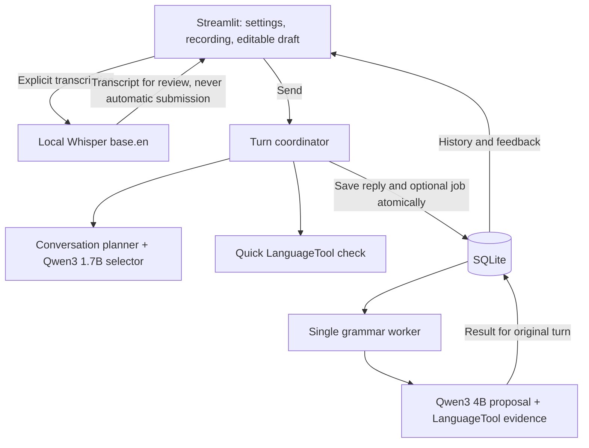

# 💬 Speakwell

**Local English practice with reviewed voice input, saved conversations, and evidence-supported grammar feedback.**


[](LICENSE)

Speakwell helps learners practise English through typed messages or completed
recordings. Review the transcript before sending, receive a conversational reply,
and explore supported grammar suggestions. Models run on your computer; completed
conversations are stored locally in SQLite.

This **Speakeasy** repository is a fresh implementation informed by
[the original Speakwell application](https://github.com/LovejitGill/Speakwell).
It focuses on one conversation workflow with straightforward Python modules.

**Jump to:** [Features](#features) · [Architecture](#architecture) · [Quickstart](#quickstart) · [Configuration](#configuration) · [Verification](#verification) · [Limitations](#limitations) · [Roadmap](#roadmap)

## Features

- **Typed practice:** beginner, intermediate, and advanced levels; daily activities,
  introductions, and ordering-food scenarios.
- **Context-aware follow-ups:** supported prepared questions, bounded recent
  history, conservative name/hobby recall, and explicit stop/no-follow-up handling.
- **Reviewed voice input:** record, transcribe locally with Whisper, edit, then
  explicitly send. Recordings and transcripts never submit themselves.
- **Two grammar checks:** a quick rule-based suggestion and an optional full check
  using a model proposal corroborated by local grammar rules. Unsupported edits
  are withheld; no correction found does not mean error-free English.
- **Saved sessions:** restore completed turns after refresh. If saving fails, keep
  the reply visible and retry without generating it again.
- **Recoverable background checks:** one grammar worker, cancellation, duplicate
  prevention, and results attached to the exact submitted turn.

## Architecture



| Module | Responsibility |
|---|---|
| `app.py` | Page controls, recording, editable drafts, and feedback display |
| `tutor.py` | Coordinate a reply, quick feedback, and saving |
| `conversation.py` / `context.py` | Select follow-ups and handle supported facts, people, and food constraints |
| `grammar.py` | Quick/full checks sharing correction evidence and explanation logic |
| `local.py` / `speech.py` | Bounded local HTTP requests and validated offline transcription |
| `storage.py` / `worker.py` | Direct SQLite operations and recoverable grammar jobs |

The model selects among prepared follow-ups rather than writing unrestricted
conversational prose. This limits invented facts but also limits flexibility.
Context includes at most **four complete learner/tutor exchanges and 3,000
characters**. Supported declarations in the current message can update recalled
facts. Corrections are displayed separately and never enter conversational history.

## Quickstart

Requires **Python 3.12.13**, **uv**, **Ollama**, and **Java 21** for LanguageTool.
Supported platforms are macOS/Linux; the worker uses an OS file lock. The lockfile
includes Intel Mac compatibility. Full grammar uses a 4B model; loading time and
memory use depend on your hardware.

**1. Install the project dependencies.** Skip cloning if already in this repository.

```bash
git clone https://github.com/LovejitGill/Speakeasy.git
cd Speakeasy
uv sync --locked
```

**2. Start Ollama in a separate terminal and leave it running.**

```bash
bash tools/ollama.sh serve
```

The launcher uses `127.0.0.1:11434` and this project's `.models/ollama` directory.
If another Ollama instance already owns that port, use the intended instance and
model directory consistently; do not run two servers on the same port.

**3. Download the models and grammar checker from another terminal.**

```bash
bash tools/ollama.sh pull qwen3:1.7b
bash tools/ollama.sh pull qwen3:4b
uv run --locked python tools/setup.py checker
uv run --locked python tools/setup.py speech
```

Downloads require internet access. Normal practice uses local services and does
not automatically download missing models.

**4. Start LanguageTool and the app, each in its own terminal.**

```bash
# Terminal A
bash tools/checker.sh
```

```bash
# Terminal B
uv run --locked streamlit run app.py
```

Open the local URL printed by Streamlit, usually `http://127.0.0.1:8501`.
Choose a level and scenario, then click **Start new session**.

For voice practice: **Record → Transcribe → Edit transcript → Use as draft → Send**.
Using the reviewed transcript replaces the typed draft. Record 0.3–60 seconds;
the app accepts mono, 16 kHz PCM16 WAV audio up to 2 MB. Silence, unclear speech,
and recoverable transcription failures leave existing drafts available.

## Configuration

Set environment variables in the terminals that launch the relevant services.
Paths below are relative to the repository unless otherwise noted.

| Variable | Default | Purpose |
|---|---|---|
| `SPEAKWELL_DB_PATH` | `data/practice.sqlite3` | SQLite database |
| `SPEAKWELL_SPEECH_MODEL` | `.models/faster-whisper-base.en` | Existing local Whisper model folder |
| `SPEAKWELL_LT_DIR` | `.tools/LanguageTool-6.6` | Checker installation; set for both the app and checker launcher |
| `SPEAKWELL_JAVA` | `java` on PATH | Java executable; set for both the app and checker launcher |
| `SPEAKWELL_OLLAMA` | `ollama` on PATH | Ollama executable used by the launcher |

Inference addresses are fixed to local services. Proxy settings and HTTP redirects
are disabled. Missing services produce prepared conversation fallbacks or
unavailable feedback, rather than remote requests.

<details>
<summary>Model identities and time budgets</summary>

Ollama model identities are checked before sending learner text:

| Use | Model tag | Required digest |
|---|---|---|
| Conversation selection | `qwen3:1.7b` | `8f68893c685c3ddff2aa3fffce2aa60a30bb2da65ca488b61fff134a4d1730e7` |
| Full grammar proposal | `qwen3:4b` | `359d7dd4bcdab3d86b87d73ac27966f4dbb9f5efdfcc75d34a8764a09474fae7` |

Changed upstream tags may fail verification. Inspect the local `/api/tags` response
and review model changes instead of bypassing identity checks. Whisper uses CPU
INT8 `base.en`, revision `3d3d5dee26484f91867d81cb899cfcf72b96be6c`.
LanguageTool must be version 6.6.

| Operation | Budget |
|---|---:|
| Quick grammar check | 0.3 seconds |
| Conversation selection | 1.4 seconds |
| Full grammar check | 55 seconds |
| Transcription | 90 seconds |

These are software deadlines, not promised response times. Cold model/checker
requests may exceed the small budgets. Whisper starts a fresh child process for
each recording, allowing timeout cleanup without saving audio, at the cost of
model reload latency.

</details>

## Verification

```bash
uv run --locked pytest -q
uv run --locked ruff check .
uv run --locked ruff format --check .
# With Ollama, both models, and LanguageTool available:
uv run --locked python tools/acceptance.py
```

The last recorded run passed **155 automated tests**, including service failures,
transaction rollback, duplicate workers, interruption recovery, stale results,
safe rendering, draft recovery, and Streamlit session restoration. Most service
tests use mocks. Real local-service smoke checks also exercised model selection,
grammar suggestions/abstention, and transcription.

The user confirmed recording permissions, playback, transcription, editable review,
explicit sending, and refresh restoration in the browser. This was a manual check,
not browser automation. A separate 24-turn conversation review identified remaining
continuity and clarification limits. These checks do not establish general
accuracy or production readiness; original Speakwell scores do not validate this app.

## Limitations

- Conversation coverage is intentionally narrow. Short replies can receive generic
  invitations or repeated closing text; topic changes need better continuity.
- Checked word explanations cover **lend/borrow** and **teach/learn**. Other direct
  questions may receive an explicit fallback; clarification currently quotes the
  prior reply rather than inventing an explanation.
- Grammar suggestions are conservative and can still be wrong. Full checks support
  single-line messages; unsupported or ambiguous corrections are withheld.
- Drafts and unsaved replies are memory-only. Refresh loses them; keep the page
  open and use **Retry saving reply** when persistence fails.
- Saved text stays on this computer; recordings are not persisted by the app.
  This is a trusted local application without accounts. Keep session URLs private.
- Interrupted grammar jobs can repeat unfinished inference after restart, but stale
  results cannot overwrite the replacement attempt.
- No continuous listening, spoken replies, pronunciation scoring, additional
  languages, or old-conversation migration is included.

The source's layered experimental engines, historical evaluation commands, and old
SQLite schema were not carried over. Useful policies and tests were adapted from
source commit `7bc00883aac7b16b96f875bb85e4f57b136482c1`; its archives remain in the
original repository.

## Roadmap

- [x] Typed practice, session persistence, and unsaved-reply recovery
- [x] Editable recorded input and manual browser/microphone verification
- [x] Shared grammar evidence and recoverable background checks
- [x] Initial conversation review and same-message recall correction
- [ ] More relevant short-answer follow-ups without repeated closing replies
- [ ] Useful clarification of supported questions
- [ ] Broader conversation and grammar review with new examples

See [improvement_plan.md](improvement_plan.md) for verification notes and next steps.

## Contributing

Keep changes focused, add behavioral tests for fixes, and run the verification
commands above. Preserve local-only inference, explicit recording submission, and
conservative correction validation.

## License

MIT — see [LICENSE](LICENSE). Third-party models and libraries retain their own licenses.
